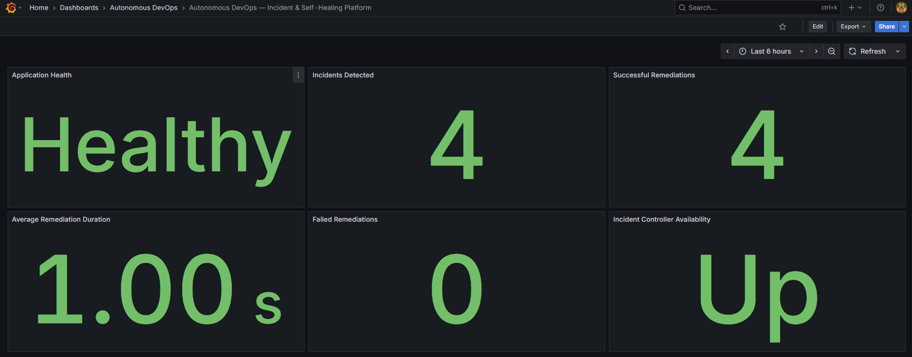
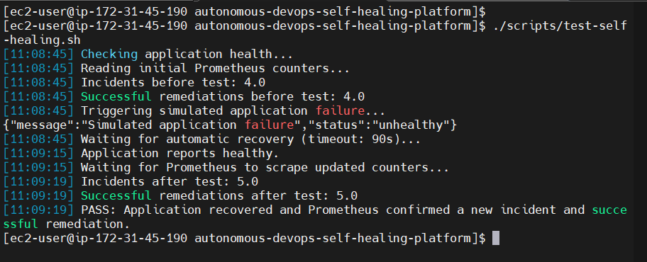
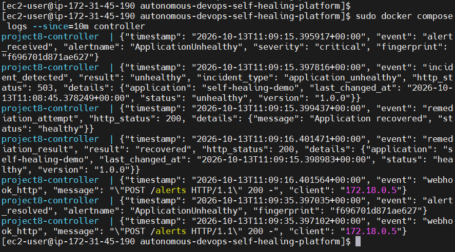

# Autonomous DevOps Incident & Self-Healing Platform

An end-to-end DevOps/SRE portfolio project demonstrating automated incident detection, alert-driven remediation, application recovery verification, and observability using Docker, Python, Prometheus, Alertmanager, and Grafana.

The platform simulates application failures, detects unhealthy behavior, triggers automated remediation, and verifies recovery through application health checks and Prometheus metrics.

## Project Overview

This project demonstrates how monitoring and alerting can be integrated with automated remediation to create a self-healing application platform.

### Key Features

- **Application Health Monitoring:** Flask application with health and Prometheus metrics endpoints.
- **Automated Incident Detection:** Prometheus evaluates configured alerting rules.
- **Alert-Driven Remediation:** Alertmanager forwards alerts to a Python incident controller through a webhook.
- **Automated Recovery:** The controller invokes the application's recovery endpoint for the demonstrated failure scenario.
- **Observability:** Prometheus collects application and incident-controller metrics.
- **Grafana Dashboard:** Six panels visualize application health, incidents, remediation outcomes, controller availability, and remediation duration.
- **Automated Testing:** A shell script validates application recovery and verifies metric changes.
- **Containerized Deployment:** Docker Compose orchestrates the application and monitoring services.
- **Security-Conscious Access:** Monitoring interfaces are restricted to localhost where configured and can be accessed through SSH tunneling.

## Grafana Dashboard

The Grafana dashboard provides a centralized view of application health and the self-healing workflow.



### Dashboard Panels

1. **Application Health:** Displays the current application health state.
2. **Incidents Detected:** Tracks detected incidents.
3. **Successful Remediations:** Displays successful remediation attempts.
4. **Failed Remediations:** Displays failed remediation attempts.
5. **Incident Controller Availability:** Shows whether Prometheus can scrape the incident controller.
6. **Average Remediation Duration:** Displays the average recorded remediation duration.

The dashboard definition is stored in version control and provisioned through Grafana configuration.

## Self-Healing Test Evidence

The end-to-end validation script triggers a simulated failure, waits for recovery, and checks the incident and successful-remediation counters in Prometheus.



A successful test confirms that the demonstrated failure scenario recovered and that Prometheus observed the corresponding metric increases.

## Prometheus Monitoring Evidence

Prometheus collects metrics from the application and incident controller and evaluates the configured application alert rules.



The screenshots should show actual results from the running environment.

## Architecture

```text
Flask Application
       |
       | Health Checks and Metrics
       v
   Prometheus
       |
       | Alert Rule Triggered
       v
  Alertmanager
       |
       | Webhook
       v
Incident Controller
       |
       | Recovery HTTP Request
       v
Flask Application
       |
       | Recovery Verification
       v
Prometheus Metrics

Grafana <------ Prometheus
```

### Incident Lifecycle

1. The Flask application exposes health and metrics endpoints.
2. Prometheus collects application and incident-controller metrics.
3. A configured alert rule detects an unhealthy application.
4. Alertmanager forwards the alert to the incident controller.
5. The controller records the incident and attempts remediation.
6. The application recovery endpoint restores the simulated application state.
7. Prometheus records the resulting metrics.
8. Grafana visualizes application health and remediation outcomes.

The current implementation demonstrates automated recovery for a controlled application failure. General-purpose root-cause analysis, Kubernetes event correlation, and AI-driven remediation are planned enhancements.

## Technology Stack

| Technology | Purpose |
|---|---|
| Python | Application and incident-controller logic |
| Flask | Application endpoints and health checks |
| Docker | Containerization |
| Docker Compose | Multi-container orchestration |
| Prometheus | Metrics collection and alert evaluation |
| Alertmanager | Alert routing and webhook delivery |
| Grafana | Monitoring dashboards |
| Bash | End-to-end test automation |
| curl | HTTP requests and endpoint validation |
| Git and GitHub | Version control |
| AWS EC2 | Development and demonstration environment |

Terraform-managed infrastructure, Amazon EKS, and GitHub Actions integration are planned enhancements rather than completed components of the current implementation.

## Repository Structure

```text
autonomous-devops-self-healing-platform/
├── application/
│   ├── Dockerfile
│   ├── requirements.txt
│   ├── src/
│   │   └── app.py
│   └── tests/
├── chaos/
│   └── scenarios/
├── docs/
│   ├── architecture/
│   ├── postmortems/
│   ├── runbooks/
│   └── screenshots/
│       ├── grafana-dashboard.png
│       ├── self-healing-test.png
│       └── prometheus-alerts.png
├── incident-engine/
│   ├── Dockerfile
│   ├── requirements.txt
│   ├── src/
│   │   └── controller.py
│   └── tests/
├── infrastructure/
│   └── terraform/
├── monitoring/
│   ├── alertmanager/
│   ├── grafana/
│   │   ├── dashboards/
│   │   │   └── self-healing-platform.json
│   │   └── provisioning/
│   └── prometheus/
│       ├── prometheus.yml
│       └── rules/
├── scripts/
│   └── test-self-healing.sh
├── compose.yaml
├── .dockerignore
├── .gitignore
└── README.md
```

## Monitoring and Metrics

### Application Metrics

| Metric | Description |
|---|---|
| `application_health_checks_total` | Health-check counter labeled by result |
| `application_simulated_failures_total` | Number of simulated application failures |
| `application_simulated_recoveries_total` | Number of simulated recoveries |
| `application_health_status` | Numeric application health state |

### Incident Controller Metrics

| Metric | Description |
|---|---|
| `incidents_detected_total` | Detected incidents labeled by incident type |
| `remediation_attempts_total` | Remediation attempts labeled by result |
| `remediation_duration_seconds` | Histogram measuring remediation duration |
| `incident_controller_up` | Incident-controller health metric |

## Prerequisites

- Linux workstation or AWS EC2 instance
- Docker Engine
- Docker Compose plugin
- Git
- curl
- Python 3

The current implementation uses Docker Compose and does not require Amazon EKS.

## Installation and Deployment

### 1. Clone the Repository

```bash
git clone https://github.com/ashyT-Cloud/autonomous-devops-self-healing-platform.git
cd autonomous-devops-self-healing-platform
```

### 2. Validate the Compose Configuration

```bash
docker compose config -q
```

Use `sudo` with Docker commands if required by your environment.

### 3. Build and Start the Platform

```bash
docker compose up -d --build
```

### 4. Check Running Services

```bash
docker compose ps
```

### 5. Verify Application Health

```bash
curl -fsS http://localhost:8080/health
```

### 6. Access Grafana

For a local deployment, open:

`http://localhost:3000`

For a remote EC2 deployment, establish an SSH tunnel:

```bash
ssh -i /path/to/your-key.pem -L 3000:127.0.0.1:3000 ec2-user@YOUR_EC2_PUBLIC_IP
```

Keep the SSH session open and visit `http://localhost:3000` in your browser.

Use the Grafana credentials configured for your environment. Never commit credentials to Git.

### 7. Access Prometheus

For a local deployment, open:

`http://localhost:9090`

For a remote EC2 deployment where Prometheus is bound to localhost:

```bash
ssh -i /path/to/your-key.pem -L 9090:127.0.0.1:9090 ec2-user@YOUR_EC2_PUBLIC_IP
```

Keep the SSH session open and visit `http://localhost:9090`.

## End-to-End Self-Healing Validation

Run the included test script after starting the platform:

```bash
chmod +x scripts/test-self-healing.sh
./scripts/test-self-healing.sh
```

The script:

1. Confirms that the application is healthy before testing.
2. Records initial incident and successful-remediation counters.
3. Triggers a simulated application failure.
4. Waits for application recovery.
5. Queries Prometheus for updated metrics.
6. Verifies that both counters have increased.
7. Reports a passing or failing result.

### Test Configuration

| Variable | Default | Description |
|---|---|---|
| `APP_URL` | `http://localhost:8080` | Application base URL |
| `PROMETHEUS_URL` | `http://localhost:9090` | Prometheus base URL |
| `RECOVERY_TIMEOUT` | `90` | Recovery timeout in seconds |

Example:

```bash
APP_URL=http://localhost:8080 PROMETHEUS_URL=http://localhost:9090 RECOVERY_TIMEOUT=90 ./scripts/test-self-healing.sh
```

A passing test confirms that the demonstrated failure scenario recovered and that Prometheus observed the relevant incident and successful-remediation counter increases. It does not guarantee recovery from every failure mode.

## Operational Commands

Check service status:

```bash
docker compose ps
```

Inspect logs:

```bash
docker compose logs --tail=100
```

Follow logs:

```bash
docker compose logs -f app controller alertmanager prometheus grafana
```

Restart services:

```bash
docker compose restart
```

Stop services:

```bash
docker compose down
```

To remove Compose-managed volumes and persisted monitoring data when intentionally resetting the environment:

```bash
docker compose down --volumes
```

**Warning:** Removing volumes deletes persisted monitoring data.

## Security Considerations

- Never commit AWS credentials, private keys, access tokens, or passwords.
- Restrict monitoring interfaces to trusted access paths.
- Use SSH tunnels for remote access to localhost-bound monitoring services.
- Do not expose the Docker remote API to untrusted networks.
- Apply least-privilege IAM permissions to cloud integrations.
- Restrict access to remediation endpoints and controller webhooks.
- Keep remediation actions bounded and observable.
- Use controlled failure simulations instead of disrupting production.
- Review container images, dependencies, and exposed ports before deployment.
- Add appropriate authentication, authorization, secret management, and audit controls before production use.

## Cost Management

Running the project on AWS EC2 may incur compute, storage, and data-transfer charges.

- Stop or terminate resources when they are no longer needed.
- Review persistent volumes and attached resources before deleting instances.
- Monitor AWS billing and resource usage.
- Avoid provisioning managed Kubernetes infrastructure until needed.
- Verify that unused cloud resources have been removed.

AWS charges may continue for resources that remain provisioned.

## Project Status

### Implemented

- [x] Containerized Flask application
- [x] Application health and metrics endpoints
- [x] Docker Compose deployment
- [x] Prometheus metrics scraping
- [x] Prometheus application alert rules
- [x] Alertmanager webhook integration
- [x] Python incident controller
- [x] Automated remediation for the demonstrated failure scenario
- [x] Incident and remediation metrics
- [x] Grafana data-source provisioning
- [x] Grafana dashboard provisioning
- [x] Six-panel self-healing dashboard
- [x] End-to-end validation script
- [x] Successful end-to-end recovery validation

### Planned Enhancements

- [ ] Expand automated unit and integration tests.
- [ ] Add more controlled failure scenarios.
- [ ] Test remediation failure handling and alerting.
- [ ] Add structured incident records and audit history.
- [ ] Correlate incidents with deployment history and Kubernetes events.
- [ ] Provision AWS infrastructure using Terraform.
- [ ] Evaluate deployment to Amazon EKS.
- [ ] Add CI/CD validation using GitHub Actions.
- [ ] Explore AI-assisted incident analysis with human approval for sensitive operations.
- [ ] Expand operational runbooks and incident postmortem documentation.

## Learning Outcomes

- Prometheus monitoring and alerting.
- Alertmanager webhook integration.
- Python-based incident automation.
- Application health checks and recovery verification.
- Docker containerization and orchestration.
- Grafana dashboard provisioning.
- End-to-end operational testing.
- Incident and remediation observability.
- Secure access to monitoring interfaces.
- Git-based development and technical documentation.

## Disclaimer

This is an educational DevOps/SRE portfolio project, not a production-ready autonomous operations system. Production adoption requires comprehensive testing, threat modeling, access controls, auditing, failure isolation, safe remediation controls, and environment-specific reliability engineering.
